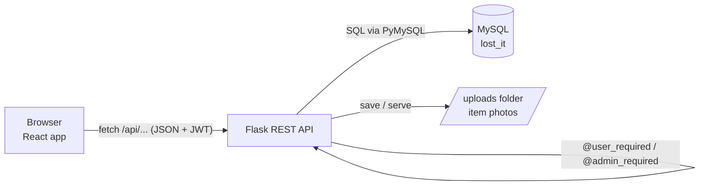
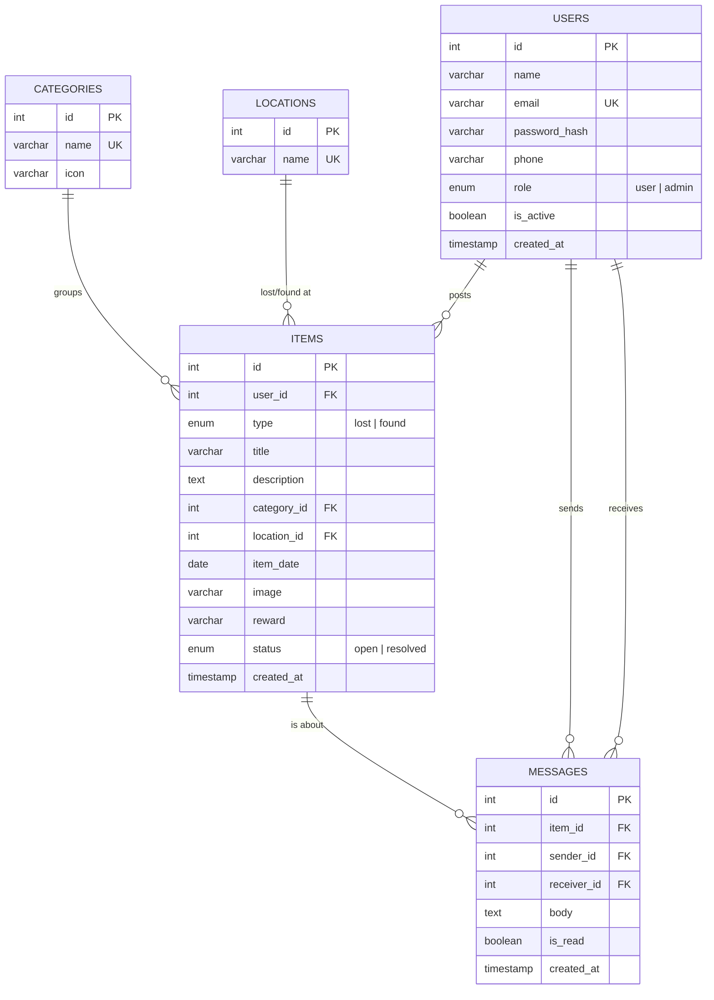

# 📦 Lost-It: Campus Lost & Found Office

Lost-It is a full-stack web app that helps students get lost things back, built as a **campus Lost & Found Office**:

- **📦 The Found Room.** Found items are sorted into **3D cardboard boxes**, one per category. Hover a box and its flaps lift while the items peek out. Click it to open the box and browse a catalogue of everything inside.
- **📜 The Wanted Board.** Lost items become **bounty-style WANTED posters** nailed to a wooden wall, with a **reward**.
- **🔎 Smart matching** links posters to boxed items automatically, and people **message each other** inside the app.
- **★ Admins** moderate posts, block users, manage categories and places, and see dashboard charts.

**Tech stack:** Python · Flask (REST API) · MySQL · React (Vite) · pure CSS 3D (no 3D libraries)

---

## ✨ Features

| Feature | What it does |
|---|---|
| 🔐 Accounts & roles | Sign up / log in, passwords hashed with Werkzeug, JWT tokens, two roles: **user** and **admin** |
| 📦 Found Room | Category boxes built from 6 CSS faces; flaps animate open; a catalogue per box with search and filters |
| 📜 Wanted Board | Parchment bounty posters with photo, last-seen place, date and reward |
| 📝 Report form | Live preview of your poster or claim tag as you type, plus optional photo upload |
| 🤝 Smart matching | Scores lost ↔ found items by category, place, date and shared keywords |
| 💬 Messaging | Contact the finder or owner without sharing phone numbers, with an unread badge |
| ✅ Case closed | Owners (or admins) mark items returned, and they get a RECOVERED / CLAIMED stamp |
| ★ Admin desk | Stats, charts by category and location, block/unblock users, promote admins, moderate items, manage categories and places |

### Roles

| | User | Admin |
|---|:---:|:---:|
| Post, browse, search, see matches, message | ✅ | ✅ |
| Close / delete **own** items | ✅ | ✅ |
| Close / delete **any** item | ❌ | ✅ |
| Block / unblock users, make admins | ❌ | ✅ |
| Add / delete categories and places | ❌ | ✅ |
| Admin dashboard | ❌ | ✅ |
| Read other people's messages | ❌ | ❌ (privacy) |

Roles are enforced in the backend with two custom Python decorators in [`backend/auth_utils.py`](backend/auth_utils.py):

```python
@bp.post("")
@user_required          # logged in AND not blocked
def create_item(): ...

@bp.get("/stats")
@admin_required         # logged in, not blocked, AND role == 'admin'
def dashboard(): ...
```

The role and blocked status are read **from the database on every request**, so blocking someone takes effect immediately, even if they're already logged in.

### How matching works

For every item, Lost-It looks at open items of the **opposite type** in the **same category** within 30 days, then scores them:

| Rule | Points |
|---|---|
| Same category (required) | 40 |
| Same location | 30 |
| Shared keywords in title/description | up to 20 (7 per word) |
| Dates within 3 days / 7 days | 10 / 5 |

Items scoring **50 or more** are shown, best first, with the reasons listed. See [`backend/routes/matching.py`](backend/routes/matching.py).

---

## 🏗️ Architecture



## 🗄️ Database design (ER diagram)



Full SQL: [`backend/schema.sql`](backend/schema.sql)

---

## 📁 Project structure

```
lost-it/
├── backend/                 Flask + MySQL API (Python)
│   ├── app.py               App setup, blueprints, image serving
│   ├── config.py            Settings loaded from .env
│   ├── db.py                MySQL connection + query helpers
│   ├── auth_utils.py        @user_required / @admin_required decorators
│   ├── schema.sql           Tables + categories/locations
│   ├── init_db.py           Creates the database from schema.sql
│   ├── seed.py              Demo users (incl. an admin), items, messages
│   ├── make_admin.py        Promote an account to admin
│   ├── routes/
│   │   ├── auth.py          /api/auth      register, login, me
│   │   ├── items.py         /api/items     browse, post, matches, resolve, delete
│   │   ├── matching.py      Match-scoring logic
│   │   ├── messages.py      /api/messages  private chat
│   │   ├── meta.py          /api/meta, /api/stats, /api/found-room
│   │   └── admin.py         /api/admin     dashboard, users, categories, places
│   └── uploads/             Uploaded photos
└── frontend/                React (Vite)
    └── src/
        ├── api.js           fetch wrapper (adds JWT token)
        ├── AuthContext.jsx  Logged-in user state
        ├── components/      CrateBox (3D box), WantedPoster, FoundCard, MatchBadge, Navbar
        └── pages/           Home, FoundRoom, FoundBox, WantedBoard, ItemDetail,
                             PostItem, MyItems, Messages, Admin, Login, Register
```

---

## 🚀 Running it locally

**You need:** Python 3.10+, Node.js 18+, MySQL 8 running locally.

### 1. Backend (Flask)

```bash
cd backend
python -m venv .venv
.venv\Scripts\activate          # Windows  (macOS/Linux: source .venv/bin/activate)
pip install -r requirements.txt

copy .env.example .env          # macOS/Linux: cp .env.example .env
# open .env and set your MySQL password (and port, if it isn't 3306)

python init_db.py               # creates the lost_it database and tables
python seed.py                  # optional: adds demo data (incl. an admin)
python app.py                   # API runs on http://localhost:5000
```

### 2. Frontend (React)

In a second terminal:

```bash
cd frontend
npm install
npm run dev                     # open http://localhost:5173
```

The React dev server forwards `/api` and `/uploads` to Flask, so both run together without extra setup.

### Demo accounts (after `seed.py`)

All demo accounts use the password **`demo1234`**.

| Email | Role |
|---|---|
| admin@campus.edu | **admin** |
| asha@campus.edu | user |
| rahul@campus.edu | user |
| fathima@campus.edu | user |
| arjun@campus.edu | user |

To make any other account an admin: `python make_admin.py someone@campus.edu`

**Try this:** open the **Found Room** and click the *Electronics* box. Then log in as Asha, open the *Black JBL wireless earphones* poster, and scroll to **Possible sightings**. Rahul's found earbuds are a 100% match.

---

## 🔌 API reference

| Method | Endpoint | Access | Description |
|---|---|---|---|
| POST | `/api/auth/register` | public | Create account → token |
| POST | `/api/auth/login` | public | Log in → token (blocked users refused) |
| GET | `/api/auth/me` | user | Current user |
| GET | `/api/items?type=&category=&location=&q=&status=` | public | Browse / search items |
| POST | `/api/items` | user | Report item (multipart, optional `image`, `reward`) |
| GET | `/api/items/mine` | user | My items |
| GET | `/api/items/<id>` | public | Item details |
| GET | `/api/items/<id>/matches` | public | Suggested matches with score and reasons |
| PATCH | `/api/items/<id>/status` | owner / admin | `{"status": "resolved" \| "open"}` |
| DELETE | `/api/items/<id>` | owner / admin | Delete item |
| GET | `/api/found-room` | public | Boxes per category with counts and previews |
| GET | `/api/meta` · `/api/stats` | public | Categories, places, home page counts |
| GET | `/api/messages` | user | My conversations |
| POST | `/api/messages` | user | Send `{item_id, body, receiver_id?}` |
| POST | `/api/messages/read` | user | Mark a chat as read |
| GET | `/api/messages/unread-count` | user | Unread badge count |
| GET | `/api/admin/stats` | admin | Totals, by-category and hotspot data |
| GET | `/api/admin/users` | admin | All users with item counts |
| PATCH | `/api/admin/users/<id>` | admin | `{"is_active": false}` or `{"role": "admin"}` |
| POST | `/api/admin/categories` · `/api/admin/locations` | admin | Add a category / place |
| DELETE | `/api/admin/categories/<id>` · `/api/admin/locations/<id>` | admin | Delete one that is unused |

---

## 🔮 Future scope

- Email notifications when a new match appears
- Image-based matching
- QR-code stickers for valuables
- Mobile app

## 📄 License

[MIT](LICENSE)
