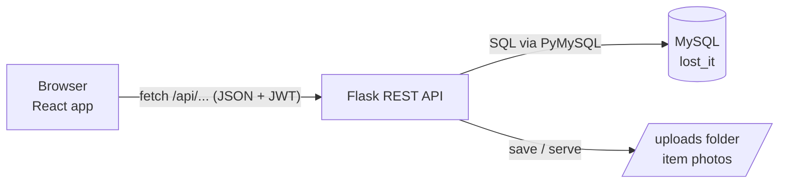
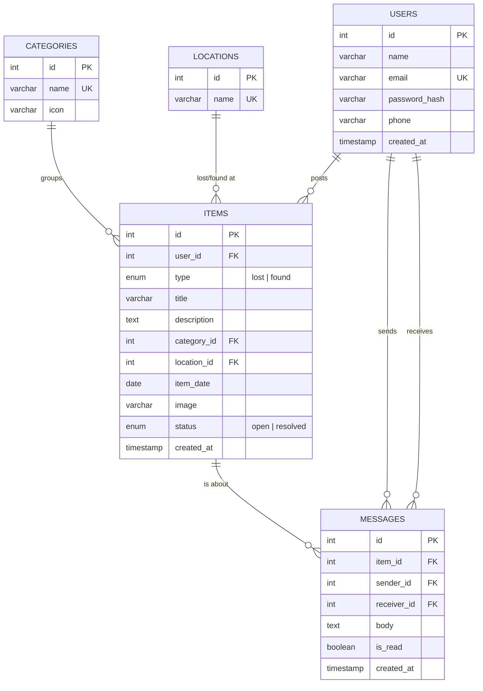

# 🔍 Lost-It: Campus Lost & Found Portal

Lost-It is a full-stack web app that helps students get lost items back.
Anyone who **loses** or **finds** something on campus can post it with a photo, place and date.
Lost-It then **suggests matching items** automatically, and the two people can **message each other** inside the app.

**Tech stack:** Python · Flask (REST API) · MySQL · React (Vite)

---

## ✨ Features

| Feature | What it does |
|---|---|
| 🔐 Sign up / log in | Passwords hashed with Werkzeug, login with JWT tokens |
| 📝 Report an item | Lost or found, with category, campus location, date, description and optional photo |
| 🔎 Browse & search | Filter by lost/found, category, location, status, plus keyword search |
| 🤝 Smart matching | Scores lost ↔ found items by category, place, date and shared keywords |
| 💬 Messaging | Contact the finder or owner without sharing phone numbers, with an unread badge |
| ✅ Mark as returned | Owners close their items once they are reunited |
| 📊 Home stats | Live counts of open lost items, found items and items returned |

### How matching works

For every item, Lost-It looks at open items of the **opposite type** in the **same category** posted within 30 days, then scores them:

| Rule | Points |
|---|---|
| Same category (required) | 40 |
| Same location | 30 |
| Shared keywords in title/description | up to 20 (7 per word) |
| Dates within 3 days / 7 days | 10 / 5 |

Items that score **50 or more** are shown, best first, with the reasons listed. See [`backend/routes/matching.py`](backend/routes/matching.py).

---

## 🏗️ Architecture



## 🗄️ Database design (ER diagram)



Full SQL: [`backend/schema.sql`](backend/schema.sql)

---

## 📁 Project structure

```
lost-it/
├── backend/                 Flask + MySQL API
│   ├── app.py               App setup, blueprints, image serving
│   ├── config.py            Settings loaded from .env
│   ├── db.py                MySQL connection + query helpers
│   ├── schema.sql           Tables + categories/locations
│   ├── init_db.py           Creates the database from schema.sql
│   ├── seed.py              Demo users, items and messages
│   ├── routes/
│   │   ├── auth.py          /api/auth   register, login, me
│   │   ├── items.py         /api/items  browse, post, matches, resolve, delete
│   │   ├── matching.py      Match-scoring logic
│   │   ├── messages.py      /api/messages  chat between users
│   │   └── meta.py          /api/meta, /api/stats
│   └── uploads/             Uploaded photos
└── frontend/                React (Vite)
    └── src/
        ├── api.js           fetch wrapper (adds JWT token)
        ├── AuthContext.jsx  Logged-in user state
        ├── components/      Navbar, ItemCard
        └── pages/           Home, Browse, ItemDetail, PostItem, MyItems, Messages, Login, Register
```

---

## 🚀 Running it locally

**You need:** Python 3.10+, Node.js 18+, MySQL 8 running locally.

### 1. Backend (Flask)

```bash
cd backend
python -m venv .venv
.venv\Scripts\activate          # Windows  (macOS/Linux: source .venv/bin/activate)
pip install -r requirements.txt

copy .env.example .env          # macOS/Linux: cp .env.example .env
# open .env and set MYSQL_PASSWORD to your MySQL root password

python init_db.py               # creates the lost_it database and tables
python seed.py                  # optional: adds demo data
python app.py                   # API runs on http://localhost:5000
```

### 2. Frontend (React)

In a second terminal:

```bash
cd frontend
npm install
npm run dev                     # open http://localhost:5173
```

The React dev server forwards `/api` and `/uploads` to Flask, so both run together without extra setup.

### Demo accounts (after `seed.py`)

| Email | Password |
|---|---|
| asha@campus.edu | demo1234 |
| rahul@campus.edu | demo1234 |
| fathima@campus.edu | demo1234 |
| arjun@campus.edu | demo1234 |

**Try this:** log in as Asha, open *"Black JBL wireless earphones"*, and look at **Possible matches**. Rahul's found earbuds come up as a strong match. Then check **Messages**.

---

## 🔌 API reference

| Method | Endpoint | Auth | Description |
|---|---|---|---|
| POST | `/api/auth/register` | | Create account → token |
| POST | `/api/auth/login` | | Log in → token |
| GET | `/api/auth/me` | ✔ | Current user |
| GET | `/api/items?type=&category=&location=&q=&status=` | | Browse / search items |
| POST | `/api/items` | ✔ | Report item (multipart form with optional `image`) |
| GET | `/api/items/mine` | ✔ | My items |
| GET | `/api/items/<id>` | | Item details |
| GET | `/api/items/<id>/matches` | | Suggested matches with score and reasons |
| PATCH | `/api/items/<id>/status` | ✔ owner | `{"status": "resolved" \| "open"}` |
| DELETE | `/api/items/<id>` | ✔ owner | Delete item |
| GET | `/api/messages` | ✔ | My conversations |
| POST | `/api/messages` | ✔ | Send message `{item_id, body, receiver_id?}` |
| POST | `/api/messages/read` | ✔ | Mark a chat as read |
| GET | `/api/messages/unread-count` | ✔ | Unread badge count |
| GET | `/api/meta` | | Categories and locations |
| GET | `/api/stats` | | Home page counts |

---

## 🔮 Future scope

- Email notifications when a new match appears
- Admin panel to moderate posts
- Image-based matching
- QR-code stickers for valuables

## 📄 License

[MIT](LICENSE)
